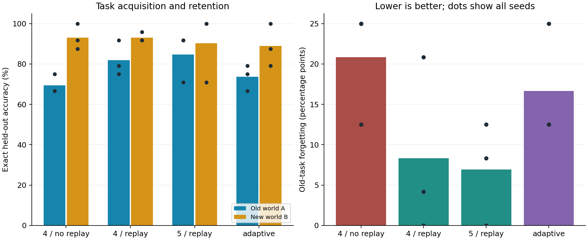

# Adaptive Llama: changing rules, memory and structural growth

Measured 11 October 2026. Native C++ / LibTorch CPU experiment, with independent
llama.cpp F16 deployment checks. This report completes the requested two-world
experiment, forgetting measurement, fixed/adaptive comparison and live viewer.
The model predicts coordinates; it is not a conversational assistant.

Development and verification of this bounded demonstrator are complete and the
experiment is closed. Native resume/export and browser checks passed. The
documented model errors and lack of adaptive advantage are measured outcomes;
they were not removed by post-hoc retuning. Alternative-architecture development
is a separate next task.

## Result

Under this declared toy-task protocol, adding 25% old-world replay to the fixed
four-layer learner reduced mean forgetting by **12.50 percentage points**.
The adaptive method proposed growth in 3/3 seeds and accepted it in
0/3. Its mean new-world test accuracy differed from the fixed four-layer
replay control by **-4.17 percentage points**. These results do not
establish a useful accuracy advantage from structural growth.



## Mean results across the three seeds

| Condition | Old A accuracy | New B accuracy | Changed B only | Forgetting |
| --- | --- | --- | --- | --- |
| Fixed 4, no replay | 69.44% | 93.06% | 94.44% | 20.83 pp |
| Fixed 4, replay | 81.94% | 93.06% | 83.33% | 8.33 pp |
| Fixed 5, replay | 84.72% | 90.28% | 94.44% | 6.94 pp |
| Adaptive, replay | 73.61% | 88.89% | 77.78% | 16.67 pp |

Each task has 24 held-out test combinations. The changed-answer subset contains
6 combinations per world. Old accuracy is after adaptation;
forgetting is old accuracy before minus after the switch. Negative forgetting
means improvement. The dots and per-seed table expose variation; three seeds
are not enough for a general superiority claim.

## All measured runs

| Seed / condition | A before | A after | B before | B after | Forgetting |
| --- | --- | --- | --- | --- | --- |
| 42 / Fixed 4, no replay | 91.7% | 66.7% | 66.7% | 91.7% | 25.0 pp |
| 42 / Fixed 4, replay | 91.7% | 91.7% | 66.7% | 91.7% | 0.0 pp |
| 42 / Fixed 5, replay | 91.7% | 91.7% | 66.7% | 100.0% | 0.0 pp |
| 42 / Adaptive, replay | 91.7% | 79.2% | 66.7% | 79.2% | 12.5 pp |
| 43 / Fixed 4, no replay | 100.0% | 75.0% | 75.0% | 100.0% | 25.0 pp |
| 43 / Fixed 4, replay | 100.0% | 79.2% | 75.0% | 95.8% | 20.8 pp |
| 43 / Fixed 5, replay | 100.0% | 91.7% | 79.2% | 100.0% | 8.3 pp |
| 43 / Adaptive, replay | 100.0% | 75.0% | 75.0% | 100.0% | 25.0 pp |
| 44 / Fixed 4, no replay | 79.2% | 66.7% | 70.8% | 87.5% | 12.5 pp |
| 44 / Fixed 4, replay | 79.2% | 75.0% | 70.8% | 91.7% | 4.2 pp |
| 44 / Fixed 5, replay | 83.3% | 70.8% | 79.2% | 70.8% | 12.5 pp |
| 44 / Adaptive, replay | 79.2% | 66.7% | 70.8% | 87.5% | 12.5 pp |

## What the model was asked to learn

In world A, R/L/U/D move right/left/up/down on a 4x4 grid. World B reverses those
four directions. Wait, obstacles and boundary clamping remain unchanged. For
example, `w=0,x=1,y=2,a=R,b=0>` maps to `2,2;`, while the same input under `w=1`
maps to `0,2;`. The world ID is supplied explicitly. This tests retaining and
selecting contextual rules; it does not test discovering an unannounced change.

The original 160 combinations keep their fixed 112/24/24 train/validation/test
partition in both worlds. No held-out combination is trained under the other
world ID. Blocked and wait cases often have unchanged answers, so changed-answer
accuracy is reported separately. All output generation is unconstrained; wrong
or malformed coordinates count as errors.

The model uses 128 hidden dimensions, four attention heads, a fixed byte
vocabulary, RMSNorm, RoPE and SwiGLU. Four layers contain 787,584 parameters;
five contain 951,680. Training is in C++ using the existing LibTorch installation.
The replay buffer contains only old training examples, never old test examples.

## Comparison and compute budget

Four conditions use seeds 42, 43 and 44. Four-layer variants share exactly the
same pretrained checkpoint per seed. Fixed five layers are trained from the
start under the same matrix-work budget. Replay batches contain exactly 12 new
and four old examples; the no-replay control uses 16 new examples.

Pretraining has a 600-four-layer-update budget; adaptation has 400. The declared
compute proxy is three times the forward dense-matrix multiply-add count:

`batch * sequence * (width*vocabulary + layers*(4*width^2 + 3*width*FF + 2*sequence*width))`.

The factor of three approximates forward plus backward computation. It excludes
nonlinearities, normalization, Adam, validation, checkpointing and export. Thus
these are approximately matched matrix-work budgets, not exact FLOPs or equal
wall-clock budgets. Integer updates can leave a small unused remainder.

| Condition | Pretrain updates | Adaptation updates, all branches | Proxy used | Training CPU time |
| --- | --- | --- | --- | --- |
| Fixed 4, no replay | 600 | 400 | 100.00% | 19.97 s |
| Fixed 4, replay | 600 | 400 | 100.00% | 22.85 s |
| Fixed 5, replay | 488 | 325 | 99.77% | 24.98 s |
| Adaptive, replay | 600 | 372 | 99.95% | 23.76 s |

CPU times above include all adaptation training branches, including rejected
candidates; they exclude validation/export and pretraining. Measurements ran
serially with two CPU threads on a shared Intel i5-1335U laptop. Other workloads
remained active. Wall time and CPU time differ; no isolated speed advantage is
claimed. Full per-run timing and matrix-work values are in the JSON evidence.

The final campaign invocation took 290.17 s wall time and 577.95 s process CPU time, with 193.48 MiB peak RSS. It resumed after a deliberate pause at initial update 100; these invocation totals exclude that earlier process. The segment counters include its training. Shared pretraining is performed once for the three four-layer conditions, so summing attributed per-condition pretraining times overcounts actual campaign work.

## Structural decision and its cost

The adaptive learner first receives 100 new-world updates with replay. If new
validation accuracy is below 98%, loss above 0.02, or old validation accuracy has
dropped more than two points, it proposes a fifth identity-initialized block.
Otherwise it spends the remaining budget continuing four layers.

When proposed, the remaining matrix-work budget is split between the continued
four-layer control and the five-layer candidate. Both start from the same warm
checkpoint and sampling state. The larger candidate gets fewer updates; both
branches are charged to the adaptive method. As a result, the selected branch
receives fewer updates than a fixed model that spends its entire budget on one
trajectory. This is an explicit search cost, not hidden extra compute.

Acceptance requires at least 1% lower new-world validation loss, non-regressing
new accuracy, and old validation accuracy no worse than the control and within
two percentage points of the pre-switch reference. Final-test metrics never
enter this decision. The rule is written by us, not learned by the model.

| Seed | Proposed / accepted | Control B loss | Candidate B loss | Control / candidate A accuracy |
| --- | --- | --- | --- | --- |
| 42 | yes / no | 0.27067 | 0.10128 | 58.3% / 87.5% |
| 43 | yes / no | 0.07015 | 0.10731 | 66.7% / 70.8% |
| 44 | yes / no | 0.25393 | 0.26804 | 75.0% / 75.0% |

## What can be concluded

Replay and structural growth are separate mechanisms. In this setup, retaining
old examples has a measurable benefit, but replay does not guarantee zero
forgetting in every seed. The fixed-five-layer control helps separate extra
capacity from an adaptive search procedure. Extra capacity and a successful
layer insertion do not by themselves establish a useful adaptation policy.

A concrete limitation appeared in seed 42. The five-layer candidate improved
new-world validation loss from 0.27067 to 0.10128 and old-world validation
accuracy from 58.33% to 87.50% relative to its continued control. However, the
pre-switch old-world validation reference was 91.67%; a 4.17-point loss exceeds
the predeclared two-point guard. The rule therefore rejected this candidate
and chose a control with worse retention. **The fallback is not a retention
guarantee.** With only 24 validation examples, even one error costs 4.17 points,
so the two-point threshold effectively allows no lost correct example. This
shows a limitation of the selection rule, not proof that every growth candidate
is worse. We did not relax the rule after seeing the results or evaluate
rejected candidates on the test set.

This experiment is small, uses a supplied task ID, and has only 6 changed-answer
test combinations and three random seeds. Results are sensitive to initialization,
training budget, replay ratio and the decision rule. The study was not tuned
against the final test outcomes. It does not establish a new learning paradigm,
open-ended self-improvement, natural-language ability or frontier intelligence.

## Live and offline inspection

The live viewer is at http://127.0.0.1:8090/ while its Node server runs. It reads
atomic status snapshots from the C++ trainer, checks once per second and stops
polling when the campaign is complete. The trainer measures after each 50-update
chunk. A short highlight means a new measurement arrived; it is not an animation
of individual neuron activation. The history slider can inspect a real candidate
with five layers and compare its old/new validation curves.

The versioned offline report is `experiments/adaptive-llama/examples/continual.html`.
Open it directly in a browser; no login, model or server is required. Final test
comparisons are separated from the validation timeline. The machine-readable
snapshot is `continual.json` alongside it.

From the repository root, start a new run manually:

```bash
./experiments/adaptive-llama/tools/run.sh campaign \
  artifacts/adaptive-llama/my-campaign
```

In a second terminal, serve its live measurements:

```bash
node experiments/adaptive-llama/tools/live.cjs \
  artifacts/adaptive-llama/my-campaign
```

Resume an interrupted campaign with `run.sh campaign-resume DIRECTORY`. Keep all
run files together. The native learner, Adam, random state and segment timing
are checkpointed atomically. Completed conditions and baseline checkpoints are
reused. Stop the viewer separately with Ctrl+C. No boot/login service is created.

## Try the model in the official llama.cpp chat

Start the existing llama.cpp built-in web UI with the trained snapshot:

```bash
./experiments/adaptive-llama/tools/start-chat.sh
```

Open http://127.0.0.1:8088/ and start a new conversation. The model name is
`Adaptive-Llama-Toy`; the default snapshot is seed 42, adaptive with replay.
This is the same llama.cpp interface used for Qwen, now serving the tiny model.
The separate measurement viewer stays at port 8090.

Send the following strings exactly, without Markdown backticks:

| Message | Expected | Observed model answer |
| --- | --- | --- |
| `w=0,x=1,y=2,a=R,b=0>` | `2,2;` | `0,2;` (wrong) |
| `w=1,x=1,y=2,a=R,b=0>` | `0,2;` | `0,2;` (correct) |
| `w=1,x=1,y=2,a=R,b=1>` | `1,2;` | `1,2;` (correct) |

The first error illustrates old-world forgetting. The expected answers come
from the world rules; the chat displays only the model's generated answer,
without a simulator replacing it. Checks use greedy generation and four tokens.

The custom chat template sends only the latest user message, stripped of outer
whitespace. System messages and previous turns are absent from the predictor's
input. This provides no conversational memory, chat learning or natural-language
competence. Use a text-only coordinate prompt. The visible chat history is a UI
record. Do not attach files.

Defaults are temperature 0, top-k 1, repeat penalty 1 and max tokens 4. Previous
browser preferences may override UI defaults: reset those fields if necessary.
The model is held in RAM until Ctrl+C stops the server. This manual server holds
the adaptive experiment lock; stop it before training. Qwen uses the same port:
stop the existing server before switching. An optional first launcher argument
selects another generated GGUF snapshot. No boot/login service is installed.

Configuration authority: the experiment README records the exact selected GGUF,
its SHA-256, model alias, local addresses, runtime bounds and observed responses.
The versioned launcher is `experiments/adaptive-llama/tools/start-chat.sh`; the
chat template and UI defaults are `ui/last-user.jinja` and `ui/llama-settings.json`
in the same experiment directory. Changes to these settings must update that
record. The source files live in Git; generated models remain in ignored artifacts.

## Deployment and verification

All 12 selected models were exported in F32 and F16 GGUF. Native/llama.cpp logits
passed the existing 0.0003 F32 and 0.02 F16 maximum-error thresholds. F16 llama.cpp
exact accuracy matched native accuracy on both test worlds and the changed-answer
subset. A four-layer F16 file is 1,592,576 bytes; five layers are 1,921,824 bytes.

The GGUF is a frozen predictor. The adaptation rule, replay and optimizer are
in the C++ learner/native checkpoints, not executable logic inside GGUF.
The complete campaign retains approximately 408 MiB of local checkpoints and
exports, despite the small size of each inference model. These are generated
artifacts, not extra model downloads, and are excluded from Git.

The separate verification manifest records source/artifact hashes and native,
resume, UI and document checks. A live test observed an actual 150-to-200 update
transition, and the browser supports recorded four/five-layer history inspection.

Efficiency review: task examples remain in memory; metrics are measured only at
bounded checkpoints; status JSON is written once per observation. The browser
uses one read-only status request per second and stops after completion. The
viewer serves only its page and status, on loopback. Export checks recompute
short prefixes for correctness; they are not an optimized serving benchmark.

## Next research boundary

The separate alternative-architecture project has not been implemented by this
campaign. The user supplied TypeSafe AI's Jev/System One Models as a reference
for that next discussion. Its architecture, access and claims need separate
assessment; Jev is not the JEPA research line. No Jev API or model was used here.
