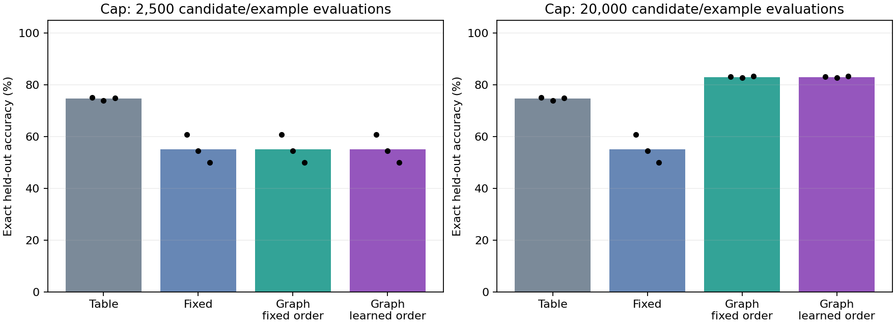

# Repair Graph: first alternative-architecture pilot

Measured 11 October 2026. Status: first bounded C++ prototype implemented and
verified; the broader alternative-architecture research remains open.
This report records 264 conditions: 72 development and 192 final evaluations,
using three seeds, four methods and two search budgets. No pretrained model,
transformer, LibTorch dependency or remote inference was used.

## Result and decision

At the 20,000-evaluation cap, changing the symbolic graph reached **83.07%**
mean final accuracy versus **55.11%** for the fixed affine predictor.
The learned repair selector reached **83.07%**, with the same operator
sequences and work as the fixed selector on every final task. This pilot supports
useful representation changes within its grammar, but provides **no evidence
that repair-policy learning improves transfer or search efficiency**.

The combined gated-delay family reached only 32.29% with either structural
selector, below the fixed predictor on that family. Search consumed its budget
before some composed candidates could be fully evaluated. A bounded search can
therefore make the selected model worse on test data despite validation gains.
No final-test-guided parameter changes or reruns were used to hide that outcome.



## Final results

Each row averages 24 final tasks: three seeds, four task families and two gains.
All methods receive identical training, validation and test examples per task.

| Method | Cap | Accuracy | First trial | Mean work |
| --- | --- | --- | --- | --- |
| Tabular | 2,500 | 74.67% | 74.67% | 64 |
| Tabular | 20,000 | 74.67% | 74.67% | 64 |
| Fixed affine | 2,500 | 55.11% | 55.11% | 992 |
| Fixed affine | 20,000 | 55.11% | 55.11% | 992 |
| Graph / fixed order | 2,500 | 55.11% | 55.11% | 2123 |
| Graph / fixed order | 20,000 | 83.07% | 55.11% | 7992 |
| Graph / learned order | 2,500 | 55.11% | 55.11% | 2123 |
| Graph / learned order | 20,000 | 83.07% | 55.11% | 7992 |

The tabular control memorizes delta frequencies keyed by action, gate and noise,
using the same supplied x+delta scaffold. It has no delay state. Its work counts
training record insertions; symbolic work counts candidate/example predictions.
These are declared resource proxies, not equivalent machine instructions.
The fixed-affine control refits coefficients once. The fixed structural selector
is also the repair-policy-memory-disabled ablation; their definitions coincide.

## Final accuracy by family at the larger cap

| Method | Parameter | Gate | Delay | Gated delay |
| --- | --- | --- | --- | --- |
| Tabular | 100.00% | 100.00% | 32.94% | 65.76% |
| Fixed affine | 100.00% | 33.07% | 28.26% | 59.11% |
| Graph / fixed order | 100.00% | 100.00% | 100.00% | 32.29% |
| Graph / learned order | 100.00% | 100.00% | 100.00% | 32.29% |

## Per-seed final results at the larger cap

| Seed | Tabular | Fixed affine | Graph / fixed | Graph / learned |
| --- | --- | --- | --- | --- |
| 42 | 75.10% | 60.74% | 83.11% | 83.11% |
| 43 | 74.02% | 54.59% | 82.81% | 82.81% |
| 44 | 74.90% | 50.00% | 83.30% | 83.30% |

## What actually learns

The simulator is a one-dimensional cart, an observed binary gate, and an
independent noisy sensor. An episode has two actions. The first action becomes
available to prediction only through an introduced delayed dependency. The
learner gets observations and experienced outcomes; task-family labels and
simulator gains are used only by the experiment driver and report.

The supplied scaffold is x_next = x + delta. The initial graph predicts delta
with an affine expression of the current action. It can refit coefficients,
split into two expressions according to an observed sensor, or add Delay(a).
A split and a delay may coexist. The search space and integer coefficients
are deliberately small and designed by us. This is constrained symbolic program
induction, not discovery of arbitrary primitives or a proven new architecture.

Graph data are typed coefficients, a split-sensor identifier and a delayed-input
flag. They encode a bounded executable expression graph. Candidate copies are
fitted using training evidence; validation MSE plus a 0.001 complexity penalty
determines acceptance. The complexity penalty is 3 base units, 2 for delay,
3 for splitting, and one per nonzero coefficient. It is not an SVG node count.
A rejected or partially evaluated candidate never replaces the current graph.

The repair policy stores six training-task descriptors per seed and each
operator's validation improvement divided by search work. At prediction time,
three nearest descriptors rank the available operators. This is an implemented
empirical policy, but its transferred ordering did not improve in this pilot.
Its memory is frozen on development and final tasks.

## Data boundaries and interpretation

Policy training contains parameter/gate/delay tasks at gains -1 and +1.
Development uses a zero-gain task and combined gated-delay at gains -1 and +1.
Final evaluation uses all four families at gains -2 and +2; the combined family
is absent from policy training. Coefficient magnitudes remain inside the grammar.
No selection settings were tuned from development or final results in this run.

Every task contains 64 training, 32 validation and 128 test episodes. Position
ranges do not overlap: training [-3,3], validation [-7,-4], test [4,7]. The other
input combinations can recur, so this is not unseen-action-combination testing.
The known additive position scaffold makes position transfer deliberately easy.

Every condition starts from the same stable-world predictor for its seed.
This is a batch adaptation and repair-transfer test, not a continuous stream of
unannounced task changes. At most six operator trials are attempted, with caps
of 2,500 or 20,000 candidate/example evaluations. Rejected and incomplete search
is charged. Evaluation accuracy never enters selection. Recovery trials mean
trials until zero validation error, not interactions until real-world recovery.

## Retention and noise limits

The active graph can forget the original movement rule when it adapts. The old
graph is preserved separately and can be explicitly selected by the caller.
At the larger cap, mean old-task accuracy falls from 100% to 48.18% for the
fixed affine learner and to 27.57% for either structural learner. Their explicitly
retrieved archived graph remains at 100%. This is exact version preservation, not
learned routing, automatic task recognition, or simultaneous mastery.

The noise sensor is available as a split candidate. A focused test verifies
noise invariance of a learned composed graph. Passive feature rejection does
not establish curiosity or resistance to every noisy environment. Active
experiment selection and random-exploration controls remain a separate gate.

## Size, work and local execution

The entire native campaign took 0.0400 seconds wall time and
0.0391 seconds CPU time, with 4.12 MiB peak RSS.
These are one short shared-host observation, not a stable serving benchmark or
comparison with transformer throughput. Report generation and browser checks
are outside that measurement. Each native checkpoint is 8,365 to
8,439 bytes, including graphs, 64 experiences, six repair records,
previous action and RNG state. No model was downloaded.

Policy training costs 159,552 candidate/example evaluations
across the three seeds. It is additional to the online caps and produced no
measured online saving here. The common initial graph costs 960 evaluations per
seed and is shared across that seed's conditions. CPU/wall measurements include
policy training, fitting, ranking, evaluation and checkpoint writes. The search
proxy excludes ranking/sorting overhead and report-only scoring; it is not FLOPs.

The runtime is C++17 with the standard library, one CPU thread, a 512 MiB
address-space ceiling and a 15-minute timeout. Learning uses bounded in-memory
arrays. Files are written once per completed condition, never inside candidate
scoring loops. A checkpoint is data; the C++ executable supplies its semantics.
It is not GGUF and stock llama.cpp cannot execute this graph. No boot/login
service or background learning daemon is installed.

## Run and inspect

```bash
./experiments/alternative-architecture/tools/build.sh
./experiments/alternative-architecture/tools/run.sh test
./experiments/alternative-architecture/tools/run.sh campaign
```

The campaign prints its results in the supplied new output directory. Existing
output directories are rejected to preserve evidence. Rerun a campaign in a new
directory; whole-campaign interruption recovery is not implemented in this pilot.
The learner itself supports exact checkpoint restoration and subsequent repair.

The recorded measurement is artifacts/alternative-architecture/pilot-01.
The English README records the exact viewer command and native prediction example.
Open http://127.0.0.1:8091/ while its manually started read-only viewer is running,
or open experiments/alternative-architecture/examples/pilot.html offline.
Choose a run, move the repair slider, and switch between before/candidate/selected
graphs. The play button animates recorded repairs. The local input form evaluates
the displayed frozen graph; it does not retrain it or simulate natural-language chat.

The server is reused from the adaptive experiment with its optional template
argument; its existing default route remains unchanged. Only page/status routes
are exposed. The PDF builder and logo-free AI Pilot cover are reused as well. Qwen and
adaptive Llama model code, models and launch configuration are unchanged.

## Verification

Native tests check disjoint position splits, held-out composed prediction,
necessity of delay, noise invariance, evidence-driven ranking versus its memory
ablation, exact checkpoint/previous-action/RNG
restoration and the same next repair after reload. Invalid schema/truncated
files are rejected. Budget exhaustion preserves the last accepted graph.
Changing final test labels leaves operator choices and graph edits unchanged.
A repeat with the final executable reproduces all 264 scientific result rows
and graph events exactly, and all 198 native checkpoints byte for byte; timing
and peak RSS are excluded from that deterministic comparison.

Browser checks cover real accepted/rejected/partial candidates, repair playback,
mobile layout, native/browser prediction parity, absence of external requests,
and restricted HTTP routes. The verification manifest records exact commands,
hashes and results. PDF text bounds and the branded cover are inspected.

## Research references and next gate

TypeSafe's Jev is a reference for typed probabilistic outputs and parallel
sampling. Its announcement describes a different decision model but does not
provide a reproducible implementation of this evolving graph. We did not use
its service or weights. Schema correctness alone does not establish a correct
world prediction. [TypeSafe announcement](https://typesafe.ai/blog/introducing-system-one-models-and-jev)

Learning reusable program representations and guiding search already have
substantial prior work. DreamCoder is a relevant example, not an implementation
reproduced here. [DreamCoder paper](https://arxiv.org/abs/2006.08381)
DreamerV3 is relevant to learned world models and behavior learning, but does
not establish our proposed repair mechanism. [DreamerV3 paper](https://arxiv.org/abs/2301.04104)

The next research gate is a separately declared repair-policy experiment:
understand why the learned cost-normalized ranking collapses to the fixed order,
and compare an independently specified alternative on fresh held-out tasks.
Do not tune this pilot's test results into a success claim. Active curiosity,
calibrated uncertainty, reusable abstraction invention and open-ended learning
remain unimplemented. No frontier-intelligence or novelty claim is supported.
