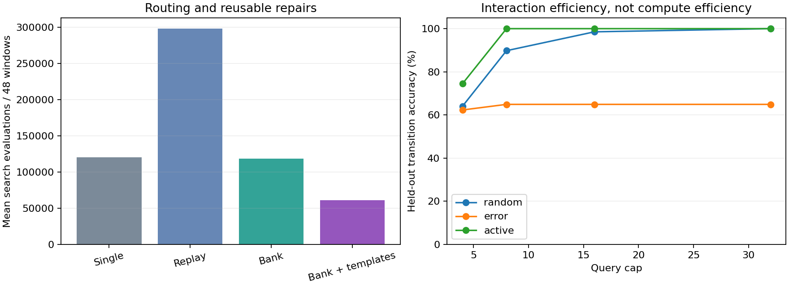

# Repair Graph v3: memory, reusable repairs and active inquiry

Measured 11 October 2026. The remaining bounded prototype gates now have native
implementations, controls, persisted state, tests and a recorded viewer. This
completes this experimental implementation; it does not demonstrate open-ended
self-improvement, a frontier model, or invention of arbitrary mathematics.

## What changed

Previously, the learner kept one current graph and one explicitly retrieved
archive. Now it retains up to 16 learned graphs and selects among them from
observations without a task identifier. Two accepted graphs with a shared shape
can produce a reusable parameterized template. A separate controlled inquiry
experiment chooses which source and action to observe using model disagreement.
All learning and query decisions run in the same C++17 executable, using the
existing graph semantics, fitting, simulator and checkpoint helpers. Python
only renders this document and plot.

## Main outcomes

- Both bank methods retained 16 distinct graphs and recovered earlier behavior
  without new search on the return phase. A single graph also reached 100% after
  re-learning, but spent 38,656 search evaluations on return
  versus 0 for the bank. Retention saves relearning here;
  it does not improve the already-perfect post-window single-model accuracy.
- Learned templates reduced mean search work by **48.61%** versus
  the same bank without templates. Including the declared routing, retention,
  matching and extraction work proxies, the reduction is **37.36%**.
  Template extraction/support learning is charged; no pretrained library is given.
- At eight queries, active inquiry reached **100.00%**
  mean held-out accuracy, versus **89.78%** for uniform
  random inquiry and **64.88%** for raw error seeking.
  Active inquiry used about **56.7 times**
  as many hypothesis evaluations as random inquiry. It saves interactions at a
  substantial compute cost; this is not a general efficiency or speed victory.



## Continual experiment: all controls

Three seeds, four methods, 48 observation windows each: **12 streams / 576 windows**.
Each window supplies 64 new training and 32 validation examples; 128 separate
held-out examples are used only for reporting. Eight +/-1 tasks are followed by
eight +/-2 tasks and a return to the first eight, with two windows per segment.
Task order is shuffled per seed. All methods see identical new evidence.

| Method | After-window accuracy | Before-window accuracy | Return accuracy | Search work | All declared work |
| --- | --- | --- | --- | --- | --- |
| single | 100.00% | 70.43% | 100.00% | 120,427 | 120,427 |
| replay | 56.76% | 46.27% | 57.67% | 298,261 | 298,261 |
| bank | 100.00% | 70.43% | 100.00% | 118,528 | 151,808 |
| bank-macros | 100.00% | 70.43% | 100.00% | 60,907 | 95,093 |

The bank without templates costs more total declared work than the single graph
over the complete sequence, because routing and witness checks have overhead.
The template-equipped bank is cheaper on this workload; none of these operation
sums is a substitute for a matched wall-clock benchmark.

The observation window is fixed and observable, but no change/segment signal,
family name or gain is passed to the learner. Recognition happens after the
window's outcomes are available. Before-window errors remain; the bank is not
an oracle capable of identifying an unobservable change before any evidence.
The last active graph alone still forgets other contexts. Simultaneous retained
knowledge is in the graph bank and its evidence-based routing, not in one graph.

Single-graph replay mixes 32 new and 32 old training examples and 16 new and
16 old validation examples from a 256-example FIFO. Conflicting unlabelled
worlds can require different answers to the same input; mixing them damages
this deterministic single predictor. This result does not disprove replay in
architectures with suitable context representations.

| Seed | Bank return accuracy | Template return accuracy | Bank search work | Template search work | Accepted template uses |
| --- | --- | --- | --- | --- | --- |
| 201 | 100.00% | 100.00% | 118,528 | 59,800 | 10 |
| 202 | 100.00% | 100.00% | 118,528 | 59,800 | 9 |
| 203 | 100.00% | 100.00% | 118,528 | 63,120 | 9 |

## What the learned abstraction contains

A library entry records an actual shared graph topology, its supporting graph
IDs, common coefficient values, and holes at coefficients that differed between
the supports. This is anti-unification of two or more different learned programs.
A candidate repair fills the holes from new training evidence with the existing
fitter; current validation evidence decides acceptance. It must predict new
coefficient values, rather than merely return a cached old answer. The nearest
observed residual descriptor ranks templates. A rejected template spends budget
and falls back to ordinary bounded search with only the remaining budget.

Templates use the existing arithmetic, gate and delayed-action primitives.
Learning a reusable combination is implemented; inventing unrestricted new
primitives is not claimed. Transfer is within the declared grammar and known
task families. The +/-2 instances are fresh, but the families are known research
fixtures from earlier pilots. Common constants may restrict transfer to other
kinds of changes; failed proposals remain visible.

A pre-measurement native fixture exposed a composition barrier: a small gated
and delayed effect can require two changes before either is individually useful.
The common v3 fallback can test their composed topology using the existing
proposer and remaining cap. This is a designed lookahead available to every
control. It is separate from learned-template benefits and does not alter v2.

## Active inquiry: every method and query cap

The learner starts with 11,790 graph hypotheses for each of two anonymous
sources. One source is the world transition, the other independent random
output. Both sources initially have the same model class; their identities are
not supplied to the learner. There are 36 possible probes of action, previous
action and binary sensors. The active rule selects maximum Gini disagreement
among predicted outputs and removes hypotheses contradicted by observations.
A source with an empty version space is unsupported by the current grammar.

| Method | Query cap | Accuracy | Used queries | Queries to unpredictable output | Hypothesis evaluations |
| --- | --- | --- | --- | --- | --- |
| random | 4 | 64.00% | 4.00 | 1.88 | 25,218 |
| error | 4 | 62.27% | 4.00 | 2.33 | 25,738 |
| active | 4 | 74.45% | 4.00 | 2.08 | 1,581,031 |
| random | 8 | 89.78% | 8.00 | 3.88 | 28,503 |
| error | 8 | 64.88% | 8.00 | 5.54 | 26,222 |
| active | 8 | 100.00% | 8.00 | 3.92 | 1,616,136 |
| random | 16 | 98.54% | 16.00 | 7.83 | 28,865 |
| error | 16 | 64.88% | 16.00 | 12.46 | 26,440 |
| active | 16 | 100.00% | 11.12 | 5.12 | 1,617,558 |
| random | 32 | 100.00% | 32.00 | 15.58 | 28,913 |
| error | 32 | 64.88% | 32.00 | 27.08 | 26,452 |
| active | 32 | 100.00% | 11.12 | 5.12 | 1,617,558 |

These are **288 conditions**: three seeds, four families, two gains, four caps
and three query rules. At the same interaction cap, query-selection computation
is not matched. Raw error seeking tends to revisit the unpredictable source;
active inquiry stops when no supported discriminating probe remains. Random
inquiry also reaches 100% at the largest budget. An empty version space can
mean missing model primitives or measurement corruption, not just randomness.

This prototype implements uncertainty-driven experiment selection and a designed
contradiction guard. It does not learn its own curiosity objective, model
stochastic transitions correctly, provide calibrated probabilities, or prove
resistance to every noisy environment. Source IDs are permuted in tests; the
noise branch is distinguished by evidence, not a hard-coded source name.

| Seed | Random accuracy at 8 | Error seeking at 8 | Active accuracy at 8 | Active queries at 32 |
| --- | --- | --- | --- | --- |
| 201 | 86.33% | 71.58% | 100.00% | 11.25 |
| 202 | 100.00% | 77.44% | 100.00% | 10.88 |
| 203 | 83.01% | 45.61% | 100.00% | 11.25 |

## Persistence, work and resources

The bank/template checkpoint is **16,988–17,143 bytes**. It contains
the active learner, up to 16 graphs, witnesses, descriptors and learned template
definitions. Query checkpoints are **6,795–66,894
bytes**, including remaining hypothesis IDs, last predictions, error windows,
query counter, compute counter and random state. The grammar itself is supplied
by the C++ runtime. These files are data, not source code or GGUF; stock llama.cpp
cannot execute them. The restored state reproduces the next decision exactly.

The complete native campaign took **0.8187 s** wall and
**0.8184 s** CPU, with **6.42 MiB** peak
RSS. This is a short shared-host observation, not a latency benchmark. One CPU
thread, 512 MiB address-space limit and 15-minute timeout apply. No model or
framework download was needed. Learning is manual, with no startup daemon.

Search work counts candidate/example evaluations, using the existing proxy.
Routing/retention count graph/example evaluations, matching counts descriptor
components, and extraction counts topology comparisons. Their sum is a declared
operation proxy, not FLOPs or interchangeable wall-clock costs. The cap applies
to search, not these other operations. Inquiry work counts hypothesis prediction
evaluations, including selecting the next query and a final stop decision.
Probability-count bookkeeping, sorting, allocation and report-only scoring are
included in CPU time but not these proxies. State is bounded in memory; writes
occur once per completed stream/condition, not inside candidate scoring loops.

## Reproduce and inspect

```bash
./experiments/alternative-architecture/tools/build.sh
./experiments/alternative-architecture/tools/run.sh test-v3
./experiments/alternative-architecture/tools/run.sh campaign-v3 NEW_DIRECTORY
.venv/bin/python experiments/alternative-architecture/tools/report.py NEW_DIRECTORY
./experiments/alternative-architecture/tools/start-viewer.sh
```

The configured recorded run is artifacts/alternative-architecture/pilot-03.
Open http://127.0.0.1:8091/ and choose memory/templates or active inquiry. The
slider and play button show real recorded decisions and their graphs. The input
form evaluates the displayed graph locally; it does not learn in the background.
The offline copy is experiments/alternative-architecture/examples/pilot-v3.html.
The experiment README documents exact selections and native prediction calls.

## Verification and scope closure

Native tests cover immutable retained evidence, automatic context return,
finite-memory rejection, unseen-window selection without task IDs, accepted
parameter-hole transfer, budget rollback, held-out-label isolation, both new
checkpoint formats and the same next decision after restoration. Inquiry tests
cover contradictory evidence, source permutation, RNG continuation and an
independently seeded composed-world fixture. Existing v1/v2 checks remain.

A separate repeat verifies the scientific rows, event histories and checkpoint
bytes. Viewer checks cover actual recorded transitions, library support,
query histories, playback, native/browser prediction agreement, offline use,
mobile layout and read-only route restrictions. Exact checks and hashes are
recorded in the v3 verification manifest. The four gates now have bounded
implementations and evidence: retention, context routing, active inquiry and
reusable graph abstractions. Broader intelligence claims remain unproven; they
are not hidden unfinished implementation items in this completed pilot.
