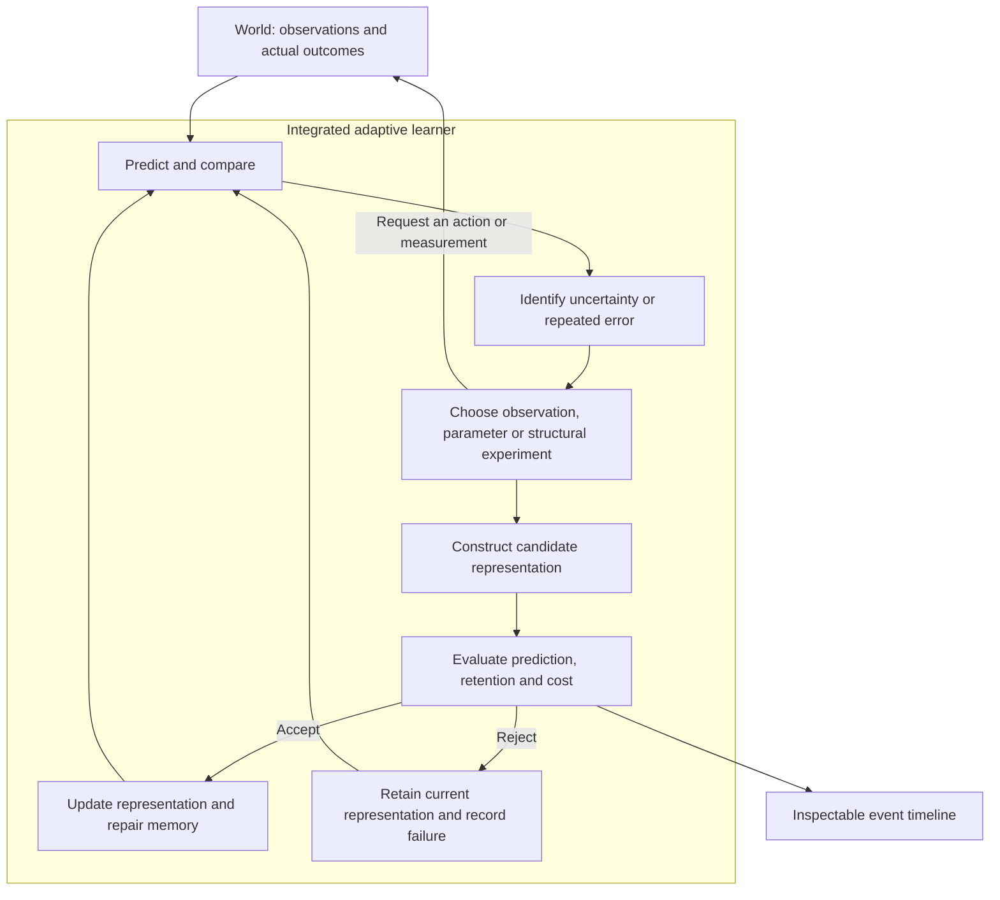

# Minimal Adaptive Intelligence — Research Plan

Date: 2026-10-11. Status: research proposal, not an implemented or validated architecture.

## 1. Objective and corrected scope

The objective is to investigate a different learning architecture whose internal representations and learning behavior develop through experience. Extending a conventional transformer with another layer does not satisfy this objective. Neither a fixed parameter count nor compatibility with an existing language-model runtime should determine the research design.

The original [research conversations](../CONVERSATION_SUMMARY.md) motivate a system that learns whether an error requires a state correction, parameter adjustment, structural change or further observation, remembers useful repairs, and transfers that experience. That is the central question of this plan.

This is one of two independent project directions. The [adaptive Llama demonstrator](ADAPTIVE_LLAMA_PLAN.md) separately explores bounded structural changes in a conventional transformer. Its implementation is not a prerequisite for this research and does not determine this project's architecture. The installed Qwen playground remains useful for studying an existing pretrained model. A small conventional predictor may serve as an experimental control, but is not the proposed destination. The Llama demonstrator's 787,584-parameter count and approximately 1.6 MB weight estimate do not apply to this research system.

A new architecture is not automatically better, and a working prototype would not by itself establish a breakthrough. The first deliverable should be a falsifiable learning experiment, followed by a minimal implementation if the design is sufficiently concrete.

## 2. Research hypothesis

**Candidate hypothesis:** a learner that jointly maintains a predictive world representation and a reusable record of successful repairs can adapt to new situations with fewer interactions or less computation than a comparable learner with a fixed representation or a fixed repair policy.

This is a proposal to test, not a claimed discovery. The integrated learner would own its current representation, prediction, memory, experiment selection, representation changes and repair-selection policy. These responsibilities can live in one component while remaining inspectable and independently testable internally.

Two distinct claims must be tested:

1. Allowing representation changes helps on a specified family of tasks.
2. Learning which change to try helps beyond a hand-written change-selection rule.

Success on the first does not establish the second. Merely moving an external training loop inside a model class establishes neither.

## 3. Candidate starting point, not a settled architecture

Investigate a small, evolving graph of predictive mechanisms. A mechanism takes selected observations, remembered state and an action, and predicts part of the next observation. Links represent proposed computational dependencies. The graph can acquire, reuse, split or combine mechanisms when evidence justifies the cost.

This is one concrete candidate for the first experiment; it is not being designated the architecture of future AI. It draws on existing ideas in world modeling, structure learning and reusable program abstractions. A literature review must identify what, if anything, is new in our formulation.

For the initial symbolic world, mechanisms can be small executable expressions with adjustable parameters. Examples of initial primitives are comparisons, arithmetic, bounded state and conditional selection. Their composition can change. A neural mechanism can be introduced later if a task requires it; a transformer stack is not a prerequisite.

We must declare the initial primitives and observation encoding. Supplying the exact task rules as primitives would undermine a claim that the system discovered them. A small predefined grammar constrains search; it does not mean the learner invents unrestricted mathematics or programs from nothing.

### State and data structures

| State | Initial candidate representation | Why it exists |
| --- | --- | --- |
| Current observations | Typed values with timestamps and sensor identifiers | Input available to the learner, distinct from simulator ground truth |
| Predictive mechanisms | Small expression graphs with typed inputs/outputs and parameters | Executable, changeable predictions |
| Dependency graph | Stable node IDs, adjacency lists and delayed-state links | Track dependencies and permit bounded structural edits |
| Episodic memory | Bounded append-only event records and replay indices | Retain actual evidence and revisit earlier behavior |
| Repair memory | Error descriptors, proposed edits, before/after metrics and cost | Learn which repairs transfer |
| Candidate states | Versioned graph, parameters and update-policy state | Compare changes and restore rejected candidates |

Limit graph size, expression depth, candidate count and search time. The first graph is acyclic within a step; explicit delayed links carry state between steps. These are proposed tractability limits, not claims about the best general architecture.

### What can change

Begin with a small set of explicit repair operators: update current state, fit an existing mechanism's parameters, introduce a bounded memory variable, split a mechanism by context, or compose/reuse an existing mechanism. Keep the initial operator set small enough that every change can be inspected.

The first selector is a transparent hand-written baseline. Subsequently, use repair outcomes from training tasks to rank operators on new tasks, for example with a small contextual policy. Record where the selector generalizes and where it fails. Its action space and learning rule remain designed by us; this does not yet amount to an algorithm that rewrites its own learning foundations.

## 4. The learning cycle

Evaluate a candidate using prediction error plus explicit penalties for representation complexity and computation. Measure retention separately and impose a recorded tolerance. Choose the scoring weights and budgets on development tasks before final evaluation; do not conceal accuracy/compute tradeoffs behind a single score.

Curiosity should favor useful uncertainty reduction or learning progress measured on separate evidence. It should not reward repeated errors on irreducible noise. An observation request, an update and a structural search all consume budget and must be counted.

A dependency edge alone is not proof of causation. Use interventions and held-out conditions when testing whether the learner distinguishes its actions from external events.

## 5. First experiment

Use a small simulated world with movement, obstacles and one controllable object. Start with typed observations rather than text tokens. Do not give the learner the simulator's transition function. Supply only its allowed observations, actions and experienced outcomes.

Introduce changes individually:

1. A stable world: learn action consequences from experience.
2. An actuator change: one action has a changed effect.
3. Partial observation: a short history becomes necessary for prediction.
4. An unrelated noisy signal: determine whether exploration wastes effort on it.
5. A new layout or related task: test transfer of representations and repair experience.

Use simulator ground truth only for evaluation where it would otherwise be hidden. For ambiguous situations, measure distributions or calibrated uncertainty; do not require perfect prediction of an unobservable random event.

The critical demonstration is a recorded change in the learner's representation or repair policy that improves performance on new situations, with its cost and effects on previous knowledge visible. Learning a single hard-coded rule is insufficient evidence for the broader hypothesis.

## 6. Controls and evidence

Compare the candidate against a tabular predictor, a fixed-structure predictor, a structurally adaptive learner with a fixed selector, and the same adaptive learner with repair memory disabled. Add random exploration as the curiosity control. Compare all learned methods on the same observation/action interface, data opportunities and declared resource limits.

Use separate training tasks for the repair policy, validation tasks for selection, and held-out task families for final transfer claims. Avoid leaking test outcomes into operator ranking. Run multiple seeds and report individual results as well as aggregates.

Measure prediction accuracy or predictive loss, interactions needed to recover after a change, old-task retention, transfer, action allocation to noise, accepted/rejected edits, graph size, CPU time, peak memory and checkpoint size. Report both equal-interaction and equal-compute comparisons when search costs differ. Start with at least three seeds as a feasibility check; stronger claims require evidence beyond that pilot.

Treat no improvement, excessive search cost, runaway growth or catastrophic forgetting as informative failures. An experiment may conclude that the proposed mechanism is not useful. Do not equate a graph visualization, increasing node count or a low training error with intelligence.

## 7. Implementation language and reusable foundations

Prefer a C++ implementation of the integrated learner and simulator. Reuse standard containers, serialization libraries and existing numerical facilities. Inspect available project/toolchain components before adding dependencies.

LibTorch can supply tensors, automatic differentiation and optimizers if the chosen mechanism needs differentiable neural components. It does not force a transformer architecture. The first symbolic/parametric graph may not need LibTorch at all; selecting a large tensor dependency before fixing the algorithm would be premature. The C++ frontend is an available foundation, not an architecture decision. [Official LibTorch tutorial](https://docs.pytorch.org/tutorials/advanced/cpp_frontend.html)

We must implement the experiment-specific representation changes, evidence bookkeeping and repair policy. We do not need to develop a general matrix library or a replacement for automatic differentiation. Performance depends on the algorithm, search space and data movement as well as implementation language; no speedup is claimed before measurement.

Reuse the existing visualization assets where practical for navigation and playback. Replace the displayed data with actual graph edits, predictions, observations and evaluations. The current Qwen attention view is not a representation of this learner. Keep a native manually launched core and a thin browser viewer initially; browser-only Rust/WASM remains a separate future deployment question.

## 8. Saving the learner and the llama.cpp boundary

Save a versioned native checkpoint containing the graph, mechanism definitions, parameters, persistent state, relevant episode/repair memory, selector state and random state. The runtime supplies the executable semantics. A JSON manifest plus binary arrays is a candidate packaging approach; choose existing serializers and record a schema before implementation.

The previous GGUF-first milestone no longer governs the architecture. Stock llama.cpp cannot be assumed to execute an arbitrary evolving graph. Its model integration documentation requires architecture and computation-graph support for new model families. [llama.cpp integration guide](https://github.com/ggml-org/llama.cpp/blob/master/docs/development/HOWTO-add-model.md)

Later deployment options are:

- Run the full adaptive learner in its native C++ runtime.
- Implement the required architecture support in llama.cpp if the resulting operations and execution model make that practical.
- Distill a frozen behavior into a supported model for inference, explicitly recognizing that this does not preserve the original learner's architecture or ongoing adaptation.

A GGUF container alone does not provide the execution or learning algorithm. Export compatibility and architectural freedom are separate goals; this revision gives priority to architectural research in response to the user's clarification. Keep the earlier llama.cpp deployment interest as a later feasibility assessment, not a silent claim that it is already satisfied.

No defensible final model-file size can be given yet. It depends on the learned graph, parameters, retained memory and checkpoint schema. Keep persistent memory and predictor size separately measurable. A small prototype is the resource objective; a particular MB figure is not yet justified.

## 9. Implementation sequence

1. **Specification:** define the observation/action interface, mechanism grammar, allowable repairs, selector baseline, objective, resource budget and held-out task split. Review related work and identify the precise experimental claim.
2. **Deterministic skeleton:** implement the simulator, native checkpoint round-trip and event playback with trivial predictors. Verify replay reproducibility. This proves tooling, not learning.
3. **Representation learning:** implement a bounded structural search and compare it with fixed predictors under matched budgets. Show an accepted and a rejected edit, with before/after evidence.
4. **Learning how to repair:** retain repair experience and test its transfer to held-out changes against the fixed-selector control. This is the central research gate.
5. **Curiosity and retention:** add experiment selection, noise tests and replay/retention measurements without changing several mechanisms at once.
6. **Assessment:** produce an English report and PDF with results, limitations, checkpoint sizes and deployment options. Decide the next experiment from evidence.

Do not start with downloading another large model, porting a complete framework, or implementing arbitrary self-rewriting source code. These actions would not establish the hypothesis.

Use manually launched, bounded CPU experiments. Before execution inspect live memory/CPU availability, avoid simultaneous Qwen inference/training loads, and leave unrelated workloads alone. Initially cap work at two threads and a 15-minute pilot with an explicit memory ceiling chosen after preflight. Include candidate graph copies and replay storage in that ceiling. No boot service, login task or background learning daemon is permitted.

Generated runs and checkpoints belong under the repository's ignored `artifacts/` or `models/` directories. Commit source, experiment configurations, small fixtures and concise evidence reports only when requested. Preserve the existing Qwen notebook and playground.

## 10. Research grounding and limits of the proposal

World models, curiosity and reusable learned structures have substantial prior work. DreamerV3 is a reference for learning an environment model and using imagined futures to improve behavior; this does not establish structural self-modification. [DreamerV3 paper](https://arxiv.org/abs/2301.04104)

DreamCoder is relevant to learning reusable program abstractions and guiding program search. It demonstrates that growing a library of representations is an existing research direction, not something we can claim as novel merely by implementing a graph. [DreamCoder paper](https://arxiv.org/abs/2006.08381)

Learning-progress-based curiosity also has a long research history. [Author's research overview](https://people.idsia.ch/~juergen/interest.html)

These are starting references, not an exhaustive survey or evidence that the proposed combination works. The candidate contribution to investigate is cost-aware, transferable selection among observation, state, parameter and representation repairs. Its novelty and utility remain open. The intended ambition is a new learning mechanism; the next concrete step is a precise experiment that could disprove our hypothesis.
