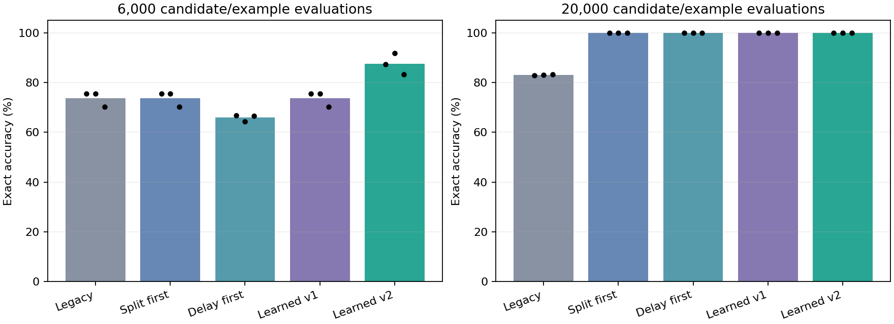

# Repair Graph v2: repair selection and composition

Measured 11 October 2026. The first follow-up addresses repair ranking and
composed changes; active curiosity, automatic task routing and abstraction
invention remain separate later gates. This is bounded symbolic program search,
not a frontier architecture or unrestricted self-improving system.

## Measured result

On 24 fresh final instances per condition, with a 6,000-evaluation search cap,
the new learned selector reached **87.50%**
versus **73.76%** for the best fixed priority order. The improvement
is **13.74 percentage points**.
All fixed orders are reported below, including equivalent permutations.

At the 20,000 cap, the new scheduler's fixed and learned selectors all reached
100% on these test instances, including the composed gated-delay family. The
legacy scheduler reached 83.07% overall.
The new learned selector used **6628** online evaluations
per task versus **7408** for the least costly fixed order: a
**10.53%** reduction in this search-work proxy.

This is a positive pilot result for repair ranking and composition within the
supplied grammar. It does not establish general superiority. The policy costs
more to train, and total work has not broken even in this small campaign.



## Every control and budget

Each entry averages three seeds, four task families and gains -2/+2 (24 tasks).
Operators: 0=refit, 1=split on a sensor, 2=add delayed action. The common scheduler
always starts with refit, so permutations 012/102/120 and 021/201/210 are equivalent.
They are not six independent pieces of evidence.

| Method | Cap | Accuracy | Composed accuracy | Search work |
| --- | --- | --- | --- | --- |
| Legacy scheduler | 2,500 | 56.61% | 59.64% | 2123 |
| Fixed 012 | 2,500 | 56.61% | 59.64% | 2123 |
| Fixed 021 | 2,500 | 56.61% | 59.64% | 2123 |
| Fixed 102 | 2,500 | 56.61% | 59.64% | 2123 |
| Fixed 120 | 2,500 | 56.61% | 59.64% | 2123 |
| Fixed 201 | 2,500 | 56.61% | 59.64% | 2123 |
| Fixed 210 | 2,500 | 56.61% | 59.64% | 2123 |
| Old learned policy | 2,500 | 56.61% | 59.64% | 2123 |
| New learned policy | 2,500 | 56.61% | 59.64% | 2123 |
| Legacy scheduler | 6,000 | 73.76% | 59.64% | 4016 |
| Fixed 012 | 6,000 | 73.76% | 59.64% | 4016 |
| Fixed 021 | 6,000 | 65.92% | 32.29% | 4704 |
| Fixed 102 | 6,000 | 73.76% | 59.64% | 4016 |
| Fixed 120 | 6,000 | 73.76% | 59.64% | 4016 |
| Fixed 201 | 6,000 | 65.92% | 32.29% | 4704 |
| Fixed 210 | 6,000 | 65.92% | 32.29% | 4704 |
| Old learned policy | 6,000 | 73.76% | 59.64% | 4016 |
| New learned policy | 6,000 | 87.50% | 50.00% | 3972 |
| Legacy scheduler | 20,000 | 83.07% | 32.29% | 7992 |
| Fixed 012 | 20,000 | 100.00% | 100.00% | 7408 |
| Fixed 021 | 20,000 | 100.00% | 100.00% | 7576 |
| Fixed 102 | 20,000 | 100.00% | 100.00% | 7408 |
| Fixed 120 | 20,000 | 100.00% | 100.00% | 7408 |
| Fixed 201 | 20,000 | 100.00% | 100.00% | 7576 |
| Fixed 210 | 20,000 | 100.00% | 100.00% | 7576 |
| Old learned policy | 20,000 | 100.00% | 100.00% | 7408 |
| New learned policy | 20,000 | 100.00% | 100.00% | 6628 |

The old learned policy and the new one share the new scheduler. The legacy
fixed control retains the original scheduler. This separates improvement from
avoiding redundant search from improvement in choosing structural repairs.
At the smallest cap, all methods stop before a complete structural candidate;
there is no accuracy advantage. At the middle cap the new learned policy helps
overall but still fails some composed cases; 100% is limited to the larger cap.

## Individual seeds

| Seed | Best fixed at 6,000 | Learned v2 at 6,000 | Fixed work at 20,000 | Learned v2 work at 20,000 |
| --- | --- | --- | --- | --- |
| 101 | 75.49% | 87.40% | 7408 | 6628 |
| 102 | 75.49% | 91.80% | 7408 | 6888 |
| 103 | 70.31% | 83.30% | 7408 | 6368 |

## Training cost and break-even

The new policy costs a mean **1,004,736** candidate/example evaluations per
seed, versus **53,184** for the old learned policy and no policy-training
cost for a fixed order. Both training procedures are included in the recorded
campaign resource measurements. Candidate generation to collect intermediate
training states is charged as well as each state's operator panel.

With a measured average online saving of 780 evaluations at the largest
cap, comparison with the cheapest fixed order would require approximately
**1,289 tasks per reused policy** to amortize its training.
This is an extrapolation assuming the same task distribution and unchanged
savings; it was not tested over that many tasks. Incremental training over v1
would require about 1,220 such tasks.
The experiment therefore demonstrates better bounded online decisions, not a
measured reduction in total training-plus-use cost or guaranteed wall-clock speed.

The proxy counts candidate/example predictions. Descriptor calculation,
neighbour search and graph-size-dependent arithmetic are not identical unit
costs. Wall/CPU measurements include this overhead, but the run is too short
and the host too shared for a reliable latency comparison.

## What changed and why

The old utility divided immediate validation improvement by operator work. On
a policy-training delay task, seed 42 assigned refit 0.0008516 versus delay
0.0002906: a cheap partial repair outranked a complete solution. Three-neighbour
averaging mixed preferences, and training contained only the initial state.

The v2 policy is still a transparent empirical selector. It uses one nearest
training descriptor, including residual correlations and whether the graph
already has delay/split dependencies. It stores normalized remaining-error
reduction, minus a small declared cost penalty. Training includes initial,
refitted and accepted intermediate states on single-mechanism tasks. Neither
family labels nor simulator gains are policy inputs. The policy is frozen on
final evaluation instances.

The common scheduler does not refit an accepted candidate that already fitted
all its coefficients on the same evidence. It skips an already-present delay
or split, and retries a rejected edit only after the graph changes. Thus a
split and delayed dependency can both be discovered before exhausting the
same declared budget. All priority controls use this scheduler; no method gets
additional simulator data or special graph primitives.

The graph and fitting grammar are unchanged from v1. Nodes still represent
predefined arithmetic, a binary conditional and an observed previous action.
The system learns their coefficients and connections, not new primitives.

## Data independence and limits

The protocol was frozen before viewing the v2 final outcomes. Seeds 101/102/103
and disjoint initial/policy/final RNG domains replace the first pilot's streams.
Each task retains 64 training, 32 validation and 128 test episodes, with disjoint
position ranges and the same supplied x+delta scaffold. Other input combinations
may recur across these partitions.

Policy training uses parameter/gate/delay at gains -1/+1, four episode sets each,
and intermediate states. Final evaluation uses gains -2/+2 and includes gated
delay. The composed family is absent from policy training but was already
examined in v1 research. This is transfer to fresh instances of known research
tasks, not validation on a family never seen during system design. No reward,
neighbor or cap sweep followed final evaluation. The middle cap was fixed from
the analytically known refit+delay versus refit+split+delay work requirements.

## Retention remains a separate problem

For the new selector at the larger cap, old-world mean accuracy falls from
100.00% to 24.67%
in the active graph. Explicit retrieval of the saved old graph retains
100.00%. This remains version preservation,
not simultaneous skill retention or automatic task routing. The repair policy's
success does not resolve that research gate.

## Native checkpoints and resources

The 648-condition campaign took 0.1432 seconds wall time,
0.1413 seconds CPU time, and 4.75 MiB
peak RSS in one observed run. It uses one C++ thread and the existing 512 MiB
address-space and 15-minute launch limits. No library/model download was needed.
These tiny finite tasks are not a throughput benchmark against language models.

Schema 2 stores seven descriptor values and bounded repair memory. The new
policy's checkpoints span 17,468
to 17,928 bytes, including
current/archived graphs, observed episodes, policy, history and RNG state.
Schema 1 remains readable and is serialized exactly as before. The native C++
runtime executes these data; they are not GGUF or natural-language models.

## Verification and use

Focused native checks passed for schema-2 round trips, identical next repair
following restore, frozen policy memory, absence of final-label leakage, budget
rollback, eligibility rules and a composed held-out fixture. The v2 campaign
reproduced all 648 scientific rows and all 648 checkpoints exactly. The original
v1 campaign also reproduced all 264 rows and 198 checkpoint files byte for byte;
wall/CPU/RSS are excluded from these deterministic comparisons.

The existing read-only graph viewer now defaults to the v2 campaign at
http://127.0.0.1:8091/. It displays actual before/candidate/selected expressions
and their measured edit history. The local prediction form evaluates the
selected frozen graph. HTTP/offline tests check native/browser parity, rollback
visibility, playback, mobile layout and restricted routes. No boot/login startup
or background learning daemon is installed. The earlier pilot remains available
offline and through an explicit run-directory argument.

```bash
./experiments/alternative-architecture/tools/build.sh
./experiments/alternative-architecture/tools/run.sh test-v2
./experiments/alternative-architecture/tools/run.sh campaign-v2
./experiments/alternative-architecture/tools/start-viewer.sh
```

The default viewer uses artifacts/alternative-architecture/pilot-02; a new
campaign prints a new directory and must be passed explicitly to the viewer.
Existing output directories are never overwritten. The README records the exact
active configuration, working examples and regeneration commands. The first
pilot and its English PDF remain historical evidence.

## Next research gate

This follow-up completes the first measured improvement to repair selection and
bounded composition. Next comes retention and automatic context selection,
then active experiment choice with a random-exploration/noise control, and
learning reusable abstractions. Those capabilities remain unimplemented; no
claim of open-ended intelligence follows from this small positive result.
