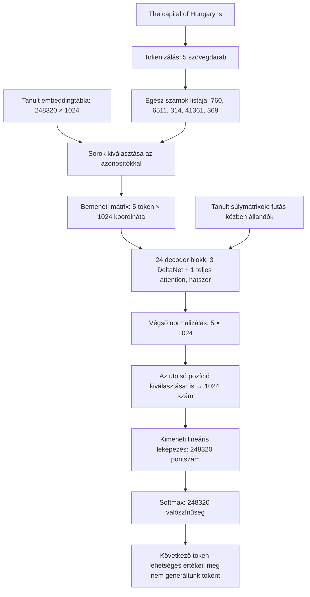

# A token útja a Qwen3.5-0.8B modellben

[Interaktív, magyar nyelvű gráf](examples/token-representation.html) ·
[A rögzített mérési adatok](examples/token-representation.json)

A HTML-fájlt böngészőben nyisd meg. Önállóan, internet és modellfuttató nélkül
működik. GitHubon a HTML forráskódként jelenhet meg; az alábbi összefoglaló
gráf a Markdown-nézetben is olvasható.

## A konkrét példa

Bemenet: `The capital of Hungary is` — nyers szöveg, chat-sablon nélkül.
A mérést az eredeti BF16 súlyokkal végeztük, a már betöltött modell újrahasználatával.



## Az adatstruktúrák és algoritmusok

- **Tokenazonosító:** szótárindex, nem egy jelentést kódoló számskála.
- **Embeddingtábla:** tanult paramétermátrix. Az azonosító kiválaszt egy sort.
  A tábla sorainak száma a konfigurációban paddinget is tartalmaz.
- **Reprezentáció:** bemenetfüggő aktivációk mátrixa. Egy tokenhez 1024 szám
  tartozik. A koordinátákhoz nem rendelünk önkényesen emberi fogalmakat.
- **Attention:** Q/K/V lineáris leképezések, Q/K-normalizálás, RoPE,
  pontszámítás, oksági maszk, softmax és súlyozott keverés. A súlyok alakja
  ennél a bemenetnél `8 × 5 × 5`; a fejek GQA szerint két K/V fejet osztanak meg.
  A kimeneti kapu és leképezés után a reprezentáció ismét `5 × 1024`.
- **DeltaNet:** oksági konvolúció és kapuzott delta-szabály. Ezt nem
  ábrázoljuk teljes softmax attention-mátrixként. A rétegek kimenete mérhető,
  de a belső állapot értelmezését ez az ábra nem végzi el.
- **MLP:** két `1024 → 3584` leképezés, SiLU és elemenkénti szorzás,
  majd `3584 → 1024` leképezés. Normalizálás és maradékkapcsolatok is
  részei a blokkoknak.
- **Kimenet:** a végső, normalizált utolsó pozíció lineáris leképezése logits
  pontszámokra, majd softmax. A kiválasztott másik token vektora nem
  helyettesíti automatikusan ezt az utolsó pozíciót.

A batch dimenziót az ábrákban elhagyjuk: egyszerre egy példát vizsgálunk.

## Mit lehet csinálni az interaktív gráfon?

1. Kattints egy tokenre. Az **ID** a szótárindexét mutatja.
2. Az **Előző / Következő** gombokkal, a csúszkával vagy a réteggombokkal
   válassz számítási állomást. A **Lejátszás** automatikusan léptet; megállítható.
3. Hasonlítsd össze a kiinduló embedding első 16 koordinátáját a kiválasztott
   réteg utáni első 16 koordinátával. A színskála minden állomáson azonos.
4. A 26. állomáson megjelenik a ténylegesen mért végső következőtoken-eloszlás
   tíz legnagyobb értéke. Ez nem egyes rétegek köztes előrejelzése.
5. Nyisd ki az algoritmusok magyarázatát a mátrixméretek alatti részben.

Az állomások: embedding, 24 teljes decoder-kimenet, végső normalizálás,
majd a következő token eloszlása. A JSON 26 mért vektorállapotot tartalmaz;
a 27. megjelenítési állomás a kimeneti eloszlás.

**Az animáció rögzített mérések visszajátszása.** Nem időarányos futásfelvétel,
nem a modell „gondolatainak” megjelenítése, és nem tanítja a modellt.
A nyilak számítási adatáramlást mutatnak, nem egyedi neuronkapcsolatokat.

## Forrás, újramérés és ellenőrzés

A meglévő `Playground.analyze()` forward pass gyűjti az adatokat. Ugyanaz a
futás szolgáltatja a Tokens, Attention map, All 24 layers, BertViz és az új
**Token flow** nézet adatait. Nincs külön modellfuttató vagy új háttérszolgáltatás.

A már megnyitott notebook régi Python-kódot tarthat a memóriában. Az új fülhöz
mentsd a saját munkádat, majd válaszd a **Kernel → Restart Kernel**, utána
**Run → Run All Cells**, végül **Analyze prompt → Token flow** lépéseket.
A fenti önálló HTML-gráf ehhez képest azonnal megnyitható.

A példa újragenerálása külön, kézi futtatással, amikor nincs másik elemzőmodell
betöltve:

```bash
.venv/bin/python tools/export_token_graph.py
```

Ellenőrzések: a megjelenített 80 embeddingkoordináta közvetlen összevetése a
checkpoint megfelelő soraival; 24 decoder-kimenet és végső normalizálás;
véges JSON-értékek; a meglévő hookok megőrzése. Böngészőben ellenőrizve a
tokenválasztás, rétegváltás, végső eloszlás, lejátszás/szünet, keskeny ablak,
és hogy a gráf nem indít külső hálózati kérést.

A checkpoint revízióját és konfigurációs méreteit a JSON rögzíti. A meglévő,
felhasználó által módosított notebookot ez a változtatás nem írja át. A HTML,
JSON, sablon, Python-kiegészítés és ez a dokumentum együtt verziókezelhető;
modellsúlyokat vagy futási hitelesítőadatokat nem tartalmaznak.
